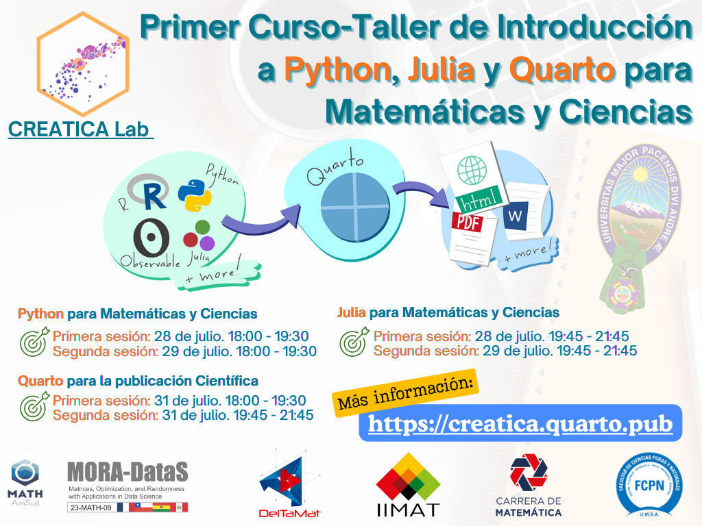

::: {#instruction-text style="font-size: 1.25em; font-weight: 400; text-align: left;"}
# [Primer Curso-Taller de Introducción a Python, Julia y Quarto para Matemáticas y Ciencias](scenarios.html)

::: {.row .visual}
::: {.quarto-figure .quarto-figure-center}
<figure class="figure">
<p></p>
</figure>
:::
:::

Este curso-taller introductorio tiene como objetivo ofrecer una visión general y accesible de tres herramientas fundamentales para el trabajo matemático y científico contemporáneo: `Python`, `Julia` y `Quarto`. A través de sesiones prácticas y ejemplos motivadores, los participantes podrán familiarizarse con cada herramienta, comprendiendo sus propósitos, fortalezas y aplicaciones típicas.

Este curso no requiere conocimientos previos en programación y está especialmente diseñado para quienes provienen de disciplinas como *Matemáticas*, *Física*, *Biología*, *Química* o afines, y que deseen incorporar el uso de software moderno en su actividad académica, docente o investigadora.

::: {style="text-align: center; margin-top: 2rem;"}
[[ Grupo de WhatsApp ]{style="display: inline-block; font-size: 1.4rem; background-color: #007bff; color: white; padding: 0.6rem 1.2rem; border-radius: 5px;"}](https://chat.whatsapp.com/G3NN448kXapCMqnDsXZszJ?mode=r_t)
:::

::: {style="text-align: center; margin-top: 2rem;"}
[[ Formulario de Inscripción ]{style="display: inline-block; font-size: 1.4rem; background-color: #007bff; color: white; padding: 0.6rem 1.2rem; border-radius: 5px;"}](https://forms.gle/LGRzREm2aUgPfqNj6)
:::

Este taller **es el primer módulo de una serie de cursos más especializados**, donde profundizaremos en temas como:

-   Programación científica con `Python` y `Julia`
-   Modelado matemático y simulación numérica
-   Elaboración de informes reproducibles y presentaciones interactivas con `Quarto`
-   Publicación de contenido científico en la web

A continuación, presentamos una breve descripción de cada herramienta
:::

::: {#instruction-note .instruction-note}
Haga clic en las columnas para ampliar el contenido. Puede hacer clic en varias columnas para comparar herramientas.
:::

::: expandable-columns
::: {.column onclick="toggleExpand(this)"}
# [Introducción a `Python` para Matemáticas y Ciencias](nature.html)

::: {.row .intro}
`Python` es un lenguaje de programación de propósito general, conocido por su simplicidad y legibilidad. Es una de las herramientas más utilizadas en el mundo para tareas que van desde el desarrollo web hasta la inteligencia artificial. En el ámbito científico, Python se ha consolidado como una opción poderosa gracias a bibliotecas como `NumPy`, `SciPy`, `Pandas`, `Matplotlib`, y `SymPy`, que permiten realizar cálculos simbólicos, numéricos y análisis de datos de forma eficiente.

Para estudiantes e investigadores de ciencias, `Python` representa una puerta de entrada versátil al mundo de la programación, con una curva de aprendizaje suave y una comunidad activa que genera constantemente recursos accesibles y actualizados

#### Primera sesión: 28 de julio de 2025. 18:00 - 19:30.

#### Segunda sesión: 29 de julio de 2025. 18:00 - 19:30.
:::

::: {.row .visual}
::: {.quarto-figure .quarto-figure-center}
<figure class="figure">
<p></p>
</figure>
:::
:::

------------------------------------------------------------------------

# Certificación

> #### Se otorgarán **GRATUITAMENTE** *Certificados de Participación* (por 10 Hrs académicas) y *Certificados de Aprobación* (a la presentación de un proyecto) a todos los docentes, estudiantes y administrativos de la *Carrera de Matemática*.

> #### En el caso de participantes de la **FCPN**, la **UMSA** u otra institución, se otorgarán *Certificados de Participación* (por 10 Hrs académicas) y *Certificados de Aprobación* (a la presentación de un proyecto), a **SOLICITUD** del participante, con el siguiente detalle de costos:
>
> -   **50 Bs. por cada curso**
> -   **120 Bs. por los tres cursos**

------------------------------------------------------------------------

# Características de la herramienta

  ---------------------------------------- -------------------------------------------------------------------
  **Tipo de software**                     Lenguaje de programación general

  **Año de creación**                      1991

  **Diseñado para**                        Propósito general (web, ciencia de datos, automatización, etc.)

  **Velocidad de ejecución**               Moderada; depende del uso de extensiones compiladas (NumPy, etc.)

  **Curva de aprendizaje**                 Suave

  **Comunidad y ecosistema**               Muy amplia y diversa

  **Uso académico/científico**             Muy extendido en ciencia de datos, IA, bioinformática, etc.

  **Soporte para notebooks**               Jupyter Notebooks

  **Compatibilidad con otros lenguajes**   Integración con C, R, Julia, etc.

  **Distribución y portabilidad**          Fácil de instalar y distribuir (Anaconda, PyPI)

  **Publicación web**                      Requiere herramientas adicionales (Flask, Django, Sphinx)

  **Aplicaciones destacadas**              Machine learning, web, scripting, automatización, visualización

  **Licencia**                             Python Software Foundation License
  ---------------------------------------- -------------------------------------------------------------------
:::

::: {.column onclick="toggleExpand(this)"}
# [Introducción a `Julia` para Matemáticas y Ciencias](culture.html)

::: {.row .intro}
`Julia` es un lenguaje de programación más reciente, diseñado específicamente para el cálculo científico y técnico de alto rendimiento. Combina la facilidad de uso de lenguajes interpretados como `Python` o `MATLAB` con la velocidad de lenguajes compilados como `C`. Julia se destaca por su capacidad para resolver problemas complejos en matemáticas aplicadas, dinámica de sistemas, álgebra lineal, ecuaciones diferenciales y optimización.

En particular, Julia permite escribir código conciso y expresivo que se ejecuta rápidamente, lo que lo convierte en una excelente elección para modelar fenómenos naturales, realizar simulaciones, y desarrollar investigación matemática computacional sin sacrificar eficiencia.

#### Primera sesión: 28 de julio de 2025. 19:45 - 21:15.

#### Primera sesión: 29 de julio de 2025. 19:45 - 21:15.
:::

::: {.row .visual}
::: {.quarto-figure .quarto-figure-center}
<figure class="figure">
<p></p>
</figure>
:::
:::

------------------------------------------------------------------------

# Certificación

> #### Se otorgarán **GRATUITAMENTE** *Certificados de Participación* (por 10 Hrs académicas) y *Certificados de Aprobación* (a la presentación de un proyecto) a todos los docentes, estudiantes y administrativos de la *Carrera de Matemática*.

> #### En el caso de participantes de la **FCPN**, la **UMSA** u otra institución, se otorgarán *Certificados de Participación* (por 10 Hrs académicas) y *Certificados de Aprobación* (a la presentación de un proyecto), a **SOLICITUD** del participante, con el siguiente detalle de costos:
>
> -   **50 Bs. por cada curso**
> -   **120 Bs. por los tres cursos**

------------------------------------------------------------------------

# Características de la herramienta

  ---------------------------------------- ---------------------------------------------------------------------------
  **Tipo de software**                     Lenguaje de programación técnico-científico

  **Año de creación**                      2012

  **Diseñado para**                        Cómputo numérico de alto rendimiento y modelado científico

  **Velocidad de ejecución**               Alta; cercano a C en muchos casos

  **Curva de aprendizaje**                 Suave a moderada (más técnica)

  **Comunidad y ecosistema**               En crecimiento, con foco en ciencia, matemática e ingeniería

  **Uso académico/científico**             Popular en matemática aplicada, dinámica de sistemas, optimización

  **Soporte para notebooks**               Pluto.jl, Jupyter

  **Compatibilidad con otros lenguajes**   Puede llamar a C, Python, R, Fortran

  **Distribución y portabilidad**          Mejora constante (distribuciones ligeras y autoconfigurables)

  **Publicación web**                      Puede usar Pluto o Documenter.jl para crear contenido web

  **Aplicaciones destacadas**              Simulación, ecuaciones diferenciales, optimización, álgebra computacional

  **Licencia**                             MIT License
  ---------------------------------------- ---------------------------------------------------------------------------
:::

::: {.column onclick="toggleExpand(this)"}
# [Introducción a `Quarto` para la Publicación Científica](society.html)

::: {.row .intro}
`Quarto` no es un lenguaje de programación, sino una plataforma para crear documentos técnicos reproducibles, combinando texto, código, resultados y visualizaciones en un mismo archivo. Inspirado en herramientas como `Rmarkdown` y `Jupyter`, Quarto permite generar informes, presentaciones, sitios web, libros o artículos científicos a partir de un mismo documento fuente.

Para matemáticos y científicos, Quarto ofrece una forma moderna y flexible de documentar su trabajo, comunicar resultados y enseñar contenidos. Se integra perfectamente con lenguajes como `R`, `Python` y `Julia`, y permite exportar a `HTML`, `PDF`, Word, o incluso publicar contenido interactivo en la web.

#### Primera sesión: 31 de julio de 2025. 18:00 - 19:30.

#### Primera sesión: 31 de julio de 2025. 19:45 - 21:15.
:::

::: {.row .visual}
::: {.quarto-figure .quarto-figure-center}
<figure class="figure">
<p></p>
</figure>
:::
:::

------------------------------------------------------------------------

# Certificación

> #### Se otorgarán **GRATUITAMENTE** *Certificados de Participación* (por 10 Hrs académicas) y *Certificados de Aprobación* (a la presentación de un proyecto) a todos los docentes, estudiantes y administrativos de la *Carrera de Matemática*.

> #### En el caso de participantes de la **FCPN**, la **UMSA** u otra institución, se otorgarán *Certificados de Participación* (por 10 Hrs académicas) y *Certificados de Aprobación* (a la presentación de un proyecto), a **SOLICITUD** del participante, con el siguiente detalle de costos:
>
> -   **50 Bs. por cada curso**
> -   **120 Bs. por los tres cursos**

------------------------------------------------------------------------

# Características de la herramienta

  ---------------------------------------- --------------------------------------------------------------------
  **Tipo de software**                     Sistema de publicación y generación de documentos reproducibles

  **Año de creación**                      2022

  **Diseñado para**                        Crear documentos reproducibles, sitios web y presentaciones

  **Velocidad de ejecución**               No aplica (es una herramienta de generación de contenido)

  **Curva de aprendizaje**                 Suave, especialmente para usuarios de R Markdown, Jupyter, LaTeX

  **Comunidad y ecosistema**               Comunidad en expansión, principalmente usuarios de R y Python

  **Uso académico/científico**             Preferido en publicaciones científicas, enseñanza y documentación

  **Soporte para notebooks**               Soporta Jupyter, R Markdown, y documentos interactivos con HTML/JS

  **Compatibilidad con otros lenguajes**   Soporta código embebido en R, Python, Julia, Observable, etc.

  **Distribución y portabilidad**          Distribución sencilla vía archivos `.qmd` y exportables a PDF/HTML

  **Publicación web**                      Genera sitios web completos (como blogs, documentación o cursos)

  **Aplicaciones destacadas**              Documentación técnica, cursos interactivos, informes reproducibles

  **Licencia**                             MIT License
  ---------------------------------------- --------------------------------------------------------------------
:::
:::

::: {#instruction-note .instruction-note}
{.margin-caption .img-fluid}
:::

::: {#instruction-note .instruction-note}
{.margin-caption .img-fluid}
:::

```{=html}
<script>
function syncRowHeights() {
const rowTypes = ["intro", "characteristics", "themes", "visual", "narrative", "lulc"]; // Extend if needed
const columns = document.querySelectorAll('.expandable-columns .column');
const anyExpanded = Array.from(columns).some(col => col.classList.contains('expanded'));

// If a column is expanded, reset all row heights
if (anyExpanded) {
  rowTypes.forEach(type => {
    const rows = document.querySelectorAll(`.row.${type}`);
    rows.forEach(row => row.style.height = 'auto');
  });
  return;
}

// Otherwise, standardize row heights across columns
rowTypes.forEach(type => {
  const rows = document.querySelectorAll(`.row.${type}`);
  let maxHeight = 0;

  // First pass: measure max height
  rows.forEach(row => {
    row.style.height = 'auto'; // Reset
    const h = row.offsetHeight;
    if (h > maxHeight) maxHeight = h;
  });

  // Second pass: apply max height
  rows.forEach(row => {
    row.style.height = maxHeight + "px";
  });
});
}

function toggleExpand(el) {
el.classList.toggle('expanded');

const columns = document.querySelectorAll('.expandable-columns .column');
const anyExpanded = Array.from(columns).some(col => col.classList.contains('expanded'));

columns.forEach(col => {
  col.classList.remove('dimmed');
  if (anyExpanded && !col.classList.contains('expanded')) {
    col.classList.add('dimmed');
  }
});

  // Hide/show instruction note
// Hide/show instruction note and text
const instructionNote = document.getElementById('instruction-note');
const instructionText = document.getElementById('instruction-text');

if (instructionNote) {
instructionNote.style.display = anyExpanded ? 'none' : 'block';
}
if (instructionText) {
instructionText.style.display = anyExpanded ? 'none' : 'block';
}

// Let the layout settle, then update row heights
requestAnimationFrame(() => {
  setTimeout(syncRowHeights, 50);
});
}

document.addEventListener("DOMContentLoaded", function () {
syncRowHeights();
});

document.addEventListener('DOMContentLoaded', function () {
const popoverTriggerList =       [].slice.call(document.querySelectorAll('[data-bs-toggle="popover"]'));
popoverTriggerList.map(function (popoverTriggerEl) {
return new bootstrap.Popover(popoverTriggerEl);
});
});

const popoverMap = {
climate: {
  content: 'IPCC cambio climático <a href="https://es.wikipedia.org/wiki/Trayectorias_de_concentración_representativas" target="_blank" rel="noopener noreferrer">Trayectorias de concentración representativas</a>.'
},
population: {
  content: "Crecimiento previsto de la población hasta 2060."
},
economy: {
  content: "PIB per cápita previsto hasta 2060 (convertido a USD utilizando la paridad del poder adquisitivo (PPA) en 2017), "
},
value: {
  content: 'Valores sociales: intrínsecos, instrumentales, etc., según el  <a href="https://www.naturefuturesframework.org/" target="_blank" rel="noopener noreferrer">IPBES-NFF</a>.'
},
protected: {
  content: "% del territorio nacional cubierto por zonas de conservación"
}
};

document.addEventListener("DOMContentLoaded", function () {
const elems = document.querySelectorAll(".popover-key");

elems.forEach(el => {
const key = el.dataset.popoverKey;
const info = popoverMap[key];
if (!info) return;

const popover = new bootstrap.Popover(el, {
  content: info.content,
  html: true,
  trigger: 'manual',
  placement: 'top',
  sanitize: false // allow your HTML links safely
});

let hideTimeout;

function clearHideTimeout() {
  if (hideTimeout) {
    clearTimeout(hideTimeout);
    hideTimeout = null;
  }
}

el.addEventListener('mouseenter', () => {
  clearHideTimeout();
  popover.show();
});

el.addEventListener('mouseleave', () => {
  hideTimeout = setTimeout(() => {
    popover.hide();
  }, 400); // increased delay to 400ms
});

// Use event delegation to handle mouseenter/mouseleave on the popover element
document.body.addEventListener('mouseenter', e => {
  const pop = document.querySelector('.popover');
  if (pop && pop.contains(e.target)) {
    clearHideTimeout();
  }
}, true);

document.body.addEventListener('mouseleave', e => {
  const pop = document.querySelector('.popover');
  if (pop && pop.contains(e.target)) {
    hideTimeout = setTimeout(() => {
      popover.hide();
    }, 400); // same delay on leaving popover
  }
}, true);
});
});
</script>
```
